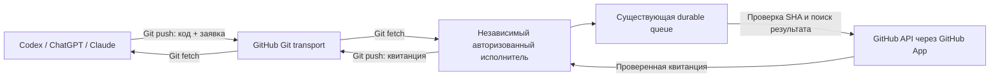

# GRAF: доставка GitHub-операций при отказе API

Состояние на 2026-10-17. Это аудит возможностей и проверяемый офлайн-прототип, **не запущенный bridge и не исправление облачного proxy**. Решение владельца о результате ещё не получено.

## Что проверено

Исходная база World_server: `9422d5730be1bd5803a0258be65ea5f469cfd60e`.

| Возможность | Наблюдение | Практический вывод |
| --- | --- | --- |
| Штатный HTTPS Git | Fetch, ls-remote и push работают через Git proxy платформы | Уже можно сохранять код и заявки независимо от API |
| `gh` | Версия 2.46.0 установлена; API-запрос завершается Forbidden | Переустановка/повторный login не устраняют CONNECT 403 |
| `api.github.com` | Envoy возвращает CONNECT 403 до TLS | Ответ не дошёл до GitHub; права токена этим не проверены |
| Сохранённые правила Codex | `api.github.com` уже разрешён; pending runtime requirements отсутствуют | Повторно сохранять тот же домен бессмысленно; инструмент не применяет runtime/restart |
| Существующий Worker, `/api/config` | Из этой среды CONNECT 403 до TLS | Нельзя заключить, что Worker выключен; нужен независимый probe |
| Существующий Cloud Run, `/api/config` | Тот же CONNECT 403 | Новый HTTP-only адрес сам по себе не решает доступ агентов |
| GitHub Actions | Свежие API-данные сейчас недоступны | Не объявлять старую billing-ошибку причиной текущего CI; не перезапускать вслепую |
| Деплой из этой среды | Cloudflare deployment credentials отсутствуют | Готовить код/проверки можно; живой деплой ещё не выполнен |
| Другие агенты | Общего доступа к приватным браузерным чатам нет | Состояние синхронизируется через GitHub/Git, не по предположениям о работе чата |

Worker: `world-server.mmmpaykin.workers.dev`; Cloud Run: `world-server-ai-studio-bridge-514578099152.europe-west2.run.app`.
Это адреса диагностики, не свежепроверенные пользовательские ссылки.
Дополнительное сетевое разрешение уже не помогло; прямой sanctioned probe без proxy не разрешил DNS. TLS не отключался, токены не извлекались.

## Что уже есть в репозитории

- `cloudflare-worker.js`, `wrangler.jsonc`: существующий Worker, `/api/config`, исходящие HTTPS-запросы, cron. **GitHub handler/App сейчас нет**. Имеющаяся D1 `TELEGRAM_DB` обслуживает игру; её нельзя молча превратить в очередь инфраструктуры.
- `scripts/deploy-cloudflare-exact-sha.cjs`: самостоятельный exact-SHA deploy без GitHub Actions. Требует Cloudflare account/token; запуск не выполнялся. Запись в work-notes о Workers Builds не доказывает, что настройка сейчас активна.
- `scripts/durable-job-queue.cjs`: Node 24 SQLite WAL/FULL, дедупликация, транзакционный claim, lease, retry/dead letter, события. Использовать отдельный DB-файл для GitHub delivery, поскольку `claim` существующего CLI выбирает все виды задач.
- `scripts/collective-brain-remote-bridge.cjs`: уже есть outbound poller, разрешённые команды, lease и повторы. Он остаётся исполнителем существующего координатора, а не поводом создавать новую систему управления проектом.
- `scripts/master-coordinator.cjs`, `lib/ai-bridge.js`: существующие координация/отчёты. JSONL и memory outbox не заменяют надёжную очередь GitHub-операций: memory outbox может отбрасывать старые элементы.

В `preparePr` существующего remote bridge обнаружен разрыв: после commit/push ошибка `gh pr create` возвращает `pushed:true`, но повтор снова проверяет dirty tree и завершается `nothing to commit`. Это вывод по исходнику; существующий bridge этим PR не изменяется. Новый протокол отделяет API-стадию от коммита, поэтому её можно возобновить для уже сохранённого SHA.

## Предлагаемый путь



HTTP API bridge — дополнительный вход для доступных ему агентов. **Git остаётся отдельным транспортом**, когда из Codex нельзя обратиться даже к bridge. Это штатные разрешённые Git-операции, не универсальный proxy/туннель. Если и Git недоступен, сохранить локальный recovery-пакет; обещать доступность при отказе всех каналов нельзя.

1. Сначала сохранить код в отдельной `ai/...` ветке и получить неизменный полный SHA.
2. Создать JSON-заявку со строгой схемой и детерминированным ID. Сохранить отдельно от source SHA, например `.ai/github-outbox/<id>.json` в выделенной ветке: заявка не может содержать SHA собственного будущего коммита.
3. Исполнитель получает её через Git; проверяет доверенный remote, разрешённого отправителя/ref, размер JSON, схему и свежий SHA исходной ветки. Хеш даёт целостность/дедупликацию, **не авторизацию**.
4. Поставить заявку в уже имеющуюся durable queue с ID как dedupe key. Никакой запуск кода, hooks, npm, shell, URL или команд из запрошенной ветки не допускается.
5. Перед записью найти PR по repo/base/head. Проверить marker операции, точный SHA, тело, draft/open. Если результат есть — сохранить квитанцию. Если конфликтует — остановиться для разбирательства.
6. После неопределённого результата POST повтор начинается с чтения, а не нового POST. Если чтение тоже недоступно — оставить задачу ожидающей. Прототип не даёт гарантии exactly-once при конкурентных исполнителях/устаревших чтениях.
7. Записать проверенную квитанцию в очередь, затем в отдельную receipt-ветку, которую агент может fetch. Экспорт квитанций должен отдельно возобновляться после сбоя push: DB `done` не доказывает доставку агенту.

Не привязывать обработку этой очереди исключительно к GitHub Actions: иначе основной отказ снова остановит доставку.

## Реализованный первый срез

`lib/github-delivery-protocol.cjs` — независимый от сети CommonJS-модуль:

```js
const { createManifest, reconcileDraftPullRequest, validateReceipt } =
  require('../lib/github-delivery-protocol.cjs');

const manifest = createManifest({
  repo: 'mpaykin1/World_server', base: 'master',
  head: 'ai/codex/example-task', sha: sourceCommitSha,
  title: 'Draft: example task', body: 'Изменения и проверки.'
});
const receipt = await reconcileDraftPullRequest(manifest, authorizedAdapter);
validateReceipt(receipt, manifest);
```

Схема: `{schemaVersion:1, operation:'create-draft-pr', repo, base, head, sha, title, body, id}`.
Разрешены только `mpaykin1/World_server`→`master` и `mpaykin1/meta6`→`main`, ветки `ai/<agent>/<task>`, lowercase SHA из 40 символов, title ≤200 и body ≤32000 символов. Неизвестные поля запрещены; идентификатор SHA-256 связан со всем содержимым. Создание Issue/комментариев ещё не реализовано.

Adapter API, который ещё требуется реализовать/авторизовать вне этого облачного proxy:

- `resolveHead({repo,head})` → актуальный SHA из GitHub, не старый cache.
- `findPullRequest({repo,base,head})` → `null` только при подтверждённом отсутствии, иначе snapshot. Ошибка/неполный поиск не означают отсутствие.
- `createDraftPullRequest({repo,base,head,sha,title,body,draft:true})` → snapshot; `sha` — локальный guard, GitHub создаёт PR по ref. После POST модуль отдельно читает PR обратно.
- Snapshot: `{repo,number,url,head,base,sha,body,draft:true,state:'open'}`. Adapter обязан проверять owner/repository head/base, пагинацию/неоднозначность поиска и нормализовать ответ.
- Receipt: `{schemaVersion:1,operationId,status:'created'|'reused',repo,number,url,sha}`. Допустима только каноническая `https://github.com/<repo>/pull/<number>`. Это проверка формы/согласованности, не криптографическая подпись доверенного отправителя.

Ошибки: `READ_UNAVAILABLE`, `WRITE_UNCERTAIN` сохраняют незавершённую операцию; `STALE_SOURCE`, `PR_CONFLICT`, ошибки схемы требуют разбора/новой заявки, а не бесконечного повтора. Не передавать наружу raw error, headers или токены. После потери ответа квитанция возникает только после подтверждающего чтения.

## Воспроизведение без установки и сети

В существующей Node 24 среде, из корня репозитория:

```sh
node --test test/github-delivery-protocol.test.cjs test/github-delivery-offline.test.cjs
ARCHITECTURE_BASE_REF=9422d5730be1bd5803a0258be65ea5f469cfd60e npm run architecture:check
```

Офлайн-тест создаёт только свои temp repositories/DB, передаёт заявку через bare Git, дважды enqueue с одним ID, теряет ответ после fake API записи, возобновляет задачу новым процессом CLI и возвращает receipt через Git. Дополнительно конкурирующие CLI-процессы получают один lease; superseded owner не может ACK после передачи lease другому уникальному owner. Временные файлы удаляются в `finally`.

Результат: **20 тестов прошли, 0 ошибок** (18 protocol + 2 offline integration). Синтаксическая проверка: 88 JS-файлов; архитектура: 3 новых code-файла; MF и IndieWorlds проверки прошли. Дополнительное ревью OpenAI нашло ошибку преобразования типа repo; она исправлена и защищена регрессией. Это ревью не заменяет Claude.

Это **локальные тесты в облачном контейнере, fake API и файловый Git**, не GitHub Actions, не реальная установка App и не live end-to-end. Полный `npm run check`/`release:gate` не запускался: существующие remote-adapter tests меняют canonical state/worktrees. До merge нужны безопасный изолированный полный прогон и ревью Claude; никаких зелёных статусов вместо непройденных проверок.

## Где запускать независимого исполнителя

| Вариант | Что переиспользуем | Что ещё нужно доказать |
| --- | --- | --- |
| Существующий cloud Node worker/remote bridge | SQLite CLI и coordinator | Наличие Node 24, постоянного диска, независимого Git/API egress и механизма запуска; этого доступа сейчас нет |
| Существующий Cloudflare Worker | HTTPS runtime, cron, exact-SHA deployment | Исходящий доступ к GitHub, новая отдельная D1 queue/адаптер, App secrets, Git transport/import/export adapter. SQLite CLI/обычный Git в Worker прямо не работают |
| Браузерный ChatGPT с GitHub | Ручная доставка PR/комментариев по сохранённой ветке | Подключённый GitHub и видимость репозитория; это немедленный временный путь, не гарантированный background worker |
| Новый бесплатный хост | Разрешён владельцем, если нужен | Сначала проверить agent→host, host→GitHub и Git+durable storage; не создавать сервер только ради нового адреса |

Приоритет: существующий исполнитель с независимым egress и диском. Если его нет — проверить Worker и объём нужного адаптера, затем выбирать хост. Бесплатность тарифа/квоты в аккаунте сейчас не подтверждена; платные планы не подключались.

## Необходимые условия перед живым запуском

1. Из независимого браузера/имеющегося cloud runtime проверить GitHub API/Git и доступность существующего Worker. Одной проверки из Codex недостаточно. Actions проверить отдельно: создаются ли jobs/steps, runners/settings/limits; никаких бесконечных rerun.
2. Выбрать существующий runtime и долговечное хранилище. Утвердить конкретные права/App/секреты, затем настроить их через интерфейс провайдера, не через чат/репозиторий. Здесь никаких секретов или прав не меняли.
3. GitHub App только на два репозитория: Metadata/read, Contents/read, Pull requests/write. Для последующих issue-комментариев — Issues/write; для диагностики CI — Actions/read и Checks/read. Contents/write добавлять лишь при утверждённом экспорте Git-квитанций, отдельно от основной операции PR.
4. Private key остаётся на исполнителе; короткоживущие installation tokens автоматически обновляются там. Не выдавать merge/bypass/admin и не подменять checks. Полученный PR всегда draft.
5. Реализовать строгую проверку trusted origin/ref/отправителя, ограниченные пути API только `api.github.com`, timeout 15 секунд, пагинацию, App token rotation, secret redaction, circuit breaker, receipt exporter. Не принимать произвольный HTTP proxy или shell endpoint.
6. Повторы: pre-TLS proxy 403 → открыть circuit/сообщить инфраструктурный blocker; 401/permission 403 → конфигурация, без login storm; rate limit → `Retry-After`; 5xx/timeout → ограниченный backoff и reconcile. Dead letters не удалять. Уникальный lease owner на запуск, heartbeat и одна активная операция на repo/head/base; старые процессы нельзя считать fenced для удалённых записей только по SQLite ACK guard. GitHub создаёт PR по ref без атомарного expected-SHA: при гонке SHA может измениться после проверки; тест подтверждает конфликт после одной записи без выдачи квитанции, а не отсутствие побочного эффекта.
7. Live crash/restart/concurrency/SHA-race/receipt-export тесты с App на тестовой ветке; реальный read-back URL/SHA; отзыв доступа и ротация ключа. Только после этого обсуждать эксплуатацию.

## Облачные настройки и правила владельца

Неограниченную сеть не включали, allowlist не расширяли. `api.github.com` уже разрешён, а инструмента применить/restart proxy нет. Для исправления самого proxy остаётся пересохранение/публикация/переподключение в интерфейсе платформы либо обращение в поддержку. Даже после этого Git fallback нужно сохранить.

В `AGENTS.md` и Desktop-протокол внесено узкое уточнение: прежний запрет на необходимые инфраструктурные компоненты снят; API/CI outage не запрещает локальную работу и draft PR. Запреты на прямой master push, обход проверок, самовольный merge, оплату и работу с секретами сохранены. Нельзя обещать отсутствие всех будущих отказов; цель — сохранять работу и возобновлять доставку после них.

## Checkpoint и продолжение в обычном браузерном ChatGPT

Ветка: `ai/codex/graf-github-delivery-20261017`. Точный опубликованный SHA и результаты — в task notes этой ветки. Действующую игру и исходники основного ChatGPT эта работа не меняет. Для прошлых игровых/метрических срезов есть отдельные ветки; продолжать их автоматически здесь не требуется.

Готовый текст для нового **обычного браузерного ChatGPT**, если GitHub API Codex остаётся заблокирован:

> Продолжи текущую инфраструктурную работу Codex в mpaykin1/World_server, ветка ai/codex/graf-github-delivery-20261017. Не создавай новый проект и не переустанавливай среду. Сначала прочитай AGENTS.md, docs/GRAF_GITHUB_DELIVERY.md и work-notes/ai/codex/graf-github-delivery-20261017.md именно в этой ветке. Codex проверил: Git работает, gh/API и существующие Worker/Cloud Run адреса получают CONNECT 403 от Envoy до TLS, хотя api.github.com разрешён. Есть офлайн-протокол draft PR + доказательство Git→существующая SQLite queue→fake API recovery→Git receipt. Живого App/runner/deploy нет. Проверь branch SHA, найди существующий PR по head/base и создай один draft PR в master, если его ещё нет; не дублируй. Опубликуй в issue #524 краткое состояние и запрос «Ревью для Claude» в PR. Не назначай PASS/FAIL — это решение владельца. Первое техническое действие: проверить из независимого runtime GitHub API egress, постоянное хранилище и существующие средства запуска; затем предложить конкретное размещение исполнителя и минимальные App permissions на World_server/meta6. Секреты только в интерфейсе провайдера. Не объявляй proxy исправленным или bridge запущенным по локальным тестам. Не изменяй master, игры или чужие модули и не обходи обязательные проверки.

Создать обычный браузерный чат автоматически имеющимися инструментами нельзя. Git сохраняет весь контекст для передачи одним сообщением.
